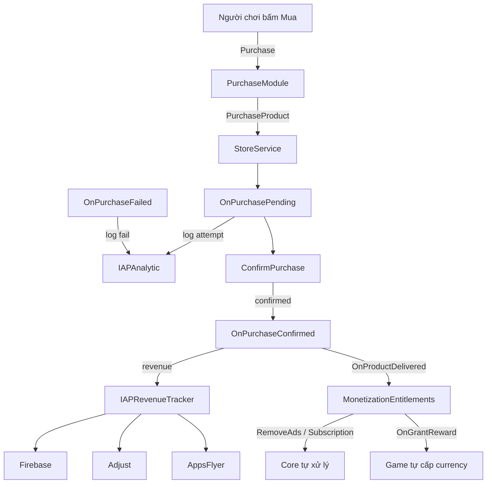

# Hướng dẫn Monetization

Tài liệu này mô tả hai hệ thống **Ads** và **IAP** nằm trong `Assets/_Monetization`:
cách từng module hoạt động, luồng tracking, các thuật ngữ chính, và cách dùng trong game.

---

## 1. Tổng quan

`Assets/_Monetization` gồm hai hệ thống con:

- **`Ads`** — các module quảng cáo chạy trên AppLovin MAX, kèm revenue tracking & analytics.
- **`IAP`** — tích hợp Unity IAP v5, kèm revenue tracking & analytics.

Hai hệ thống này **gần như độc lập**:
- Ads không phụ thuộc class của IAP.
- IAP không phụ thuộc class của Ads.

Điểm chạm duy nhất giữa chúng là **RemoveAds**: khi người chơi mua gói remove ads qua IAP,
`MonetizationEntitlements` ghi quyền lợi, và Ads tự đọc lại qua `AdsManager.IsRemoveAdsPurchased`.
Nhờ vậy bạn có thể bê riêng thư mục `Ads` sang project khác miễn là có sẵn các SDK/helper cần thiết.

> 📄 Tài liệu chuyên sâu cho IAP: [`IAP/README.md`](IAP/README.md) — hợp đồng tích hợp + 5 bước tự code cho game.
> 📄 Bản mẫu tham chiếu: [`IAP/Example/README.md`](IAP/Example/README.md).

---

## 2. Kiến trúc Ads

### Class gốc
- `AdsManager` là MonoBehaviour gốc của Ads.
- Nó khởi tạo AppLovin MAX và tạo các submodule:
  - `AppOpenModule`
  - `InterstitialModule`
  - `BannerModule`
  - `MRECModule`
  - `RewardedModule`
- Đồng thời giữ `AdRevenueTracker` để bắn revenue.

### Các module

Mỗi loại quảng cáo có module riêng:

- **`AppOpenModule`** — load & show App Open ads; xử lý lifecycle (displayed/hidden/clicked); log show/click qua `AdAnalytic`.
- **`InterstitialModule`** — load & show interstitial toàn màn hình; tuân thủ capping/delay từ remote config; log show/click + revenue.
- **`BannerModule`** — tạo & show banner; log show/click.
- **`RewardedModule`** — load & show rewarded; log watched/completed.
- **`MRECModule`** — quản lý MREC; log show/click.

### Chặn ads khi đã mua RemoveAds

Bốn loại `AppOpen`, `Interstitial`, `Banner`, `MREC` đều kiểm tra
`ApplovinManager.IsRemoveAdsPurchased` (trỏ về `MonetizationEntitlements.HasRemoveAds`).
Mua RemoveAds → cả bốn bị chặn ở tầng gating. **Rewarded vẫn hiện** — cố ý (người chơi tự
nguyện xem để nhận thưởng).

### Đường đi của revenue

Khi có sự kiện revenue:

- Module gọi `OnAdRevenuePaidEvent(...)`
- → `AdsManager.SendAdRevenueTracker(impressionData)`
- → `AdRevenueTracker.SendAllTracker(adInfo)`

`AdRevenueTracker` gửi doanh thu tới:

- **Firebase Analytics** qua `FirebaseAnalytics.LogEvent("ad_impression", ...)`
- **Adjust** qua `AdjustSdk.Adjust.TrackAdRevenue(...)` nếu bật `USE_ADJUST`
- **AppsFlyer** qua `AppsFlyerSDK.AppsFlyer.logAdRevenue(...)` nếu bật `USE_APPSFLYER`

### Sự kiện analytics

`AdAnalytic.LogAd(...)` ghi các event Firebase như:

`show_interstitial_ads`, `show_interstitial_success`, `show_interstitial_click`,
`show_rewarded_ads`, `show_rewarded_ads_sucess`, `show_rewarded_ads_click`,
`show_rewarded_ads_completed`, `show_banner_ads`, `show_banner_ads_click`,
`show_app_open_ads`, `show_app_open_ads_success`, `show_app_open_ads_click`,
`show_mrec_ads`, `show_mrec_ads_click`.

### Lưu ý cho Ads

- Ads cần `MaxSdk` / AppLovin MAX.
- Revenue tracking cần thêm Firebase, AppsFlyer và/hoặc Adjust tùy cờ biên dịch.
- Nếu chỉ dùng riêng thư mục `Ads`, mang theo các helper dùng chung:
  - `LogMessage.cs`
  - `FirebaseAnalyticManager.cs`
  - `RemoteConfigManager` / các class config dùng cho capping
  - `UIManager` nếu dùng UI resume của AppOpen

---

## 3. Kiến trúc IAP

> Chi tiết đầy đủ (khai báo sản phẩm, reward handler, truy vấn quyền lợi, cách tự code)
> nằm trong [`IAP/README.md`](IAP/README.md). Dưới đây chỉ là tóm tắt.

### Class gốc
- `IAPManager` là manager gốc của IAP, tạo & nối:
  - `IAPService` — khởi tạo Unity Services
  - `IAPCatalogModule` — build catalog sản phẩm
  - `IAPPurchaseModule` — thao tác mua hàng
  - `IAPCallbacks` — callback từ store
  - `IAPRevenueTracker` — log revenue

### Vòng đời
1. **Awake** — tạo callbacks & modules.
2. **Start** — gọi `IAPService.Initialize(...)`.
3. **OnUnityServicesReady** — build catalog + connect store.
4. **ConnectToStore** — `StoreService.Connect()` rồi fetch products qua `CatalogProvider.FetchProducts(...)`.

### Luồng mua hàng
1. Người chơi chọn sản phẩm.
2. Nút gọi `IAPManager.Instance.PurchaseModule.Purchase(productId)`.
3. `PurchaseModule` kiểm tra sẵn sàng → `PurchaseService.PurchaseProduct(product)`.
4. Store trả callback: `OnPurchasePending` → `OnPurchaseConfirmed` (hoặc `OnPurchaseFailed`).
5. Khi confirmed: giao sản phẩm (`OnProductDelivered`) + gửi revenue.

### Cấp quyền lợi (entitlements) — điểm quan trọng

`MonetizationEntitlements` tự lắng nghe `OnProductDelivered` / `OnPurchasesReady`, rồi:
- **RemoveAds** → ghi entitlement + ẩn ads.
- **Subscription** → set Owned + hạn dùng.
- **Reward khác (Money/Gem/Shield…)** → bắn event `OnGrantReward` cho **game tự xử lý**.

Nhờ vậy **core không biết gì về kinh tế game của bạn**. Chống cấp trùng dựa trên `TransactionID`
đã có sẵn — bạn không cần tự lo.

### Revenue + analytics

`IAPRevenueTracker.SendAllTracker(order)` gửi doanh thu IAP (confirmed order) tới Firebase / Adjust / AppsFlyer.
`IAPAnalytic` ghi các event Firebase: `iap_purchase_attempt`, `iap_purchase_success`,
`iap_purchase_failed`, `iap_restore_start`, `iap_restore_complete`.

> Lưu ý: `LogPurchaseAttempt` hiện fire ở `OnPurchasePending` (store đã nhận giao dịch), **không**
> phải lúc bấm nút. Muốn có event click chính xác, thêm ở `IAPButtonUI.OnClick()` hoặc
> `IAPPurchaseModule.Purchase()`.

---

## 4. Sơ đồ luồng IAP

---

## 5. Thuật ngữ chính

- **`PendingOrder`** — store đã nhận giao dịch, đang chờ xác nhận.
- **`ConfirmedOrder`** — mua thành công; đây là lúc giao vật phẩm & tính doanh thu.
- **`FailedOrder`** — mua thất bại; game xử lý fail & log.
- **`ad_impression`** — event Firebase cho ad revenue (chứa network, unit, placement, format, country, value).
- **`logAdRevenue` / `TrackAdRevenue`** — API ghi ad revenue của AppsFlyer / Adjust.
- **`OnGrantReward`** — event của `MonetizationEntitlements` để game nhận reward tùy biến (currency…).

---

## 6. Cách dùng

### Ads
1. Đặt `AdsManager` vào scene.
2. Gán ID trong `AdConstants` cho AppOpen / Interstitial / Banner / MREC / Rewarded.
3. Thêm `FirebaseAnalyticManager` nếu muốn log Firebase.
4. Bật cờ khi cần: `USE_APPSFLYER`, `USE_ADJUST`.
5. Gọi từ game code:
   - `AdsManager.Instance.InterstitialModule.ShowInterstitial(location, callback)`
   - `AdsManager.Instance.RewardedModule.ShowRewarded(location, callback)`
   - `AdsManager.Instance.BannerModule.ShowBanner()`
   - `AdsManager.Instance.AppOpenModule.ShowAppOpen(isLoading)`

### IAP
1. Đặt `IAPManager` vào scene.
2. Cấu hình asset `IAPProducts`.
3. Thêm `FirebaseAnalyticManager` nếu muốn analytics.
4. Bật `USE_IAP`.
5. Dùng nút kế thừa `IAPButtonUI` hoặc gọi `PurchaseModule.Purchase(productId)` / `RestorePurchases(callback)`.
6. Cấp currency cho game qua `MonetizationEntitlements.OnGrantReward` (xem [`IAP/README.md`](IAP/README.md)).

### Kịch bản test gợi ý
- Fetch product & hiển thị đúng tên/giá.
- Luồng mua thành công / thất bại.
- Restore purchases.
- Firebase event được bắn.
- Revenue gửi qua AppsFlyer / Adjust khi bật cờ.

---

## 7. Đã sẵn sàng & cần lưu ý

### Sẵn sàng
- Ads revenue tracking đã nối từ MAX revenue callback tới Firebase/Adjust/AppsFlyer.
- IAP revenue tracking đã nối từ confirmed order tới Firebase/Adjust/AppsFlyer.
- Firebase event logging có cho cả ads & IAP.
- RemoveAds đã nối thông từ IAP entitlement sang gating của Ads.
- IAP đã tách kinh tế game ra khỏi core qua `OnGrantReward`.

### Cần lưu ý
- `IAPAnalytic.LogPurchaseAttempt` fire ở `OnPurchasePending`, không phải lúc click.
- Tên event Firebase là custom — nên thống nhất với team UA/analytics.
- Đảm bảo `FirebaseAnalyticManager` sẵn sàng trước khi gọi analytic.
