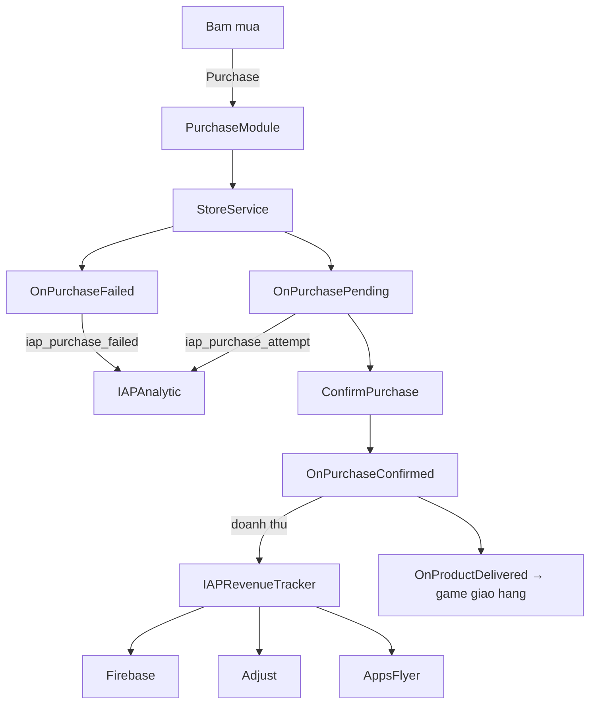

# mindongun — Monetization

| | |
|---|---|
| Package | `com.mjgame.nmd.nkl.20.monetization` |
| Ten hien thi | mindongun Monetization |
| Phien ban | **1.0.0** (2026-10-03) |
| Unity | 2022.3 tro len |
| Phu thuoc | Core `com.mjgame.nmd.nkl.20` 2.0.x |
| Tac gia | mindongun |

Package kiem tien dung chung cho game mobile Unity: quang cao (AppLovin MAX), IAP (Unity IAP v5),
Firebase Analytics / Remote Config, tracking doanh thu qua Adjust / AppsFlyer va In-App Review.
Package la **assembly rieng**, chi tham chieu Core, **khong goi toi class nao cua game**.

## Muc luc

1. [Cai dat](#cai-dat)
2. [Assembly va define](#assembly-va-define)
3. [Bat dau nhanh](#bat-dau-nhanh)
4. [Save (DataMonetization)](#save-datamonetization)
5. [Ads](#ads)
6. [IAP](#iap)
7. [Firebase va Remote Config](#firebase-va-remote-config)
8. [In-App Review](#in-app-review)
9. [Event analytics](#event-analytics)
10. [Cach game cam vao package](#cach-game-cam-vao-package)
11. [Xu ly loi thuong gap](#xu-ly-loi-thuong-gap)

---

## Cai dat

### Thu vien can co

| Thu vien | Bat buoc | Cach co |
|---|---|---|
| Core `com.mjgame.nmd.nkl.20` | Co | `package.json` (cai Core truoc) |
| Unity IAP (`com.unity.purchasing`) | Co | `package.json` (5.4.4) |
| TextMeshPro, uGUI, Newtonsoft Json | Co | `package.json` |
| **AppLovin MAX SDK** | Co | Import rieng (can `MaxSdk.Scripts.asmdef`) |
| **Firebase** Analytics, Remote Config (Crashlytics tuy chon) | Co | Import rieng (`.unitypackage`) |
| Adjust | Khong | Import rieng + define `USE_ADJUST` |
| AppsFlyer | Khong | Import rieng + define `USE_APPSFLYER` |
| Google Play In-App Review | Khi build Android | Import rieng (`com.google.play.review`) |

### Cach dua vao project

- **Chep vao `Assets/`**: chep ca folder, dam bao Core cung co trong project.
- **Package qua git**: day folder len git rieng, them vao `Packages/manifest.json`:
  `"com.mjgame.nmd.nkl.20.monetization": "<git-url>"`. Core phai duoc cai truoc.

GUID file khong doi khi chuyen giua 2 cach, prefab va scene khong mat tham chieu.

---

## Assembly va define

| Assembly | File | Nen tang | Tham chieu |
|---|---|---|---|
| `com.mjgame.nmd.nkl.20.monetization` | `Runtime/com.mjgame.nmd.nkl.20.monetization.asmdef` | Tat ca | Core, MaxSdk.Scripts, MaxSdk.Scripts.IntegrationManager.Editor, Unity.Purchasing, Unity.Services.Core(.Environments), Unity.TextMeshPro, UnityEngine.UI |
| `com.mjgame.nmd.nkl.20.monetization.Editor` | `Editor/com.mjgame.nmd.nkl.20.monetization.Editor.asmdef` | Editor | Runtime + cac thu vien tren |

- Ca 2 deu `autoReferenced`: code game (Assembly-CSharp) dung duoc ngay.
- Firebase, Newtonsoft la DLL tu dong tham chieu, khong can khai bao.
- Adjust / AppsFlyer: khi bat define, SDK phai co asmdef va **phai them ten asmdef do vao `references`** cua Runtime asmdef.

| Define | Tac dung |
|---|---|
| `USE_IAP` | Bat toan bo IAP (`IAPManager`, callback, editor test) |
| `USE_ADJUST` | Bat `AdjustManager` + gui doanh thu ads/IAP sang Adjust |
| `USE_APPSFLYER` | Bat `AppsFlyerManager` + gui doanh thu ads/IAP sang AppsFlyer |

Dat define trong `Project Settings > Player > Scripting Define Symbols` cho **tung nen tang**.

Cau truc:

```
Runtime/   AdsManager, Ads/Module, IAP, Firebase*, RemoteConfigManager, Adjust/AppsFlyer, Store, Attribute, Data
Editor/    Ads/AdsEditor, IAP/IAPEditor, IAP/IAPTestEditor
Samples~/  DataSaveBridge (DataSave mau + MonetizationBridge)
```

---

## Bat dau nhanh

1. Cai Core, MAX SDK, Firebase; them `google-services.json` / `GoogleService-Info.plist`.
2. Tao `AdConstants` (`Create > Ads > Ad Constants`), dien SDK key, ad unit id, bam **Apply Ad Ids**.
3. Neu dung IAP: tao `IAPProducts` (`Create > IAP > IAP Products`), bat `USE_IAP`.
4. Dat vao scene dau (hoac prefab load tu Bootstrap): `FirebaseManager`, `FirebaseAnalyticManager`,
   `RemoteConfigManager`, `AdsManager` (gan `AdConstants`), `IAPManager` (gan `IAPProducts`).
5. Import sample **DataSave & Bridge** tu Package Manager, sua `DataSave` cua game theo mau
   (xem [Save](#save-datamonetization)), gan `MonetizationBridge` de noi Ads/IAP voi UI.

---

## Save (DataMonetization)

Package khong tu luu. Data nam trong `DataSave` cua game (quy uoc Core: **mot file save duy nhat**).
Vi package khong thay duoc `DataSave`, no doc qua static `DataMonetization.Current`
(cung pattern voi `DataSetting.Current` cua Core).

| Thanh vien | Mo ta |
|---|---|
| `DataMonetization.Current` | Instance dang dung. Mac dinh la object rong, game gan lai sau khi load |
| `IsRemoveAdsPurchased` | Da mua Remove Ads |
| `RemoveAdsPurchased()` | Bat co Remove Ads |

`DataSave` cua game (giong `Samples~/DataSaveBridge/DataSave.cs`):

```csharp
public class DataSave : SaveBase<DataSave>
{
    private const string KEY_MONETIZATION = "data_monetization_fls";

    public DataMonetization DataMonetization { get; private set; }

    // Package chi doc DataMonetization.Current, khong goi DataSave.Instance,
    // nen phai tu tao DataSave khi vao game de load/save chay.
    [RuntimeInitializeOnLoadMethod(RuntimeInitializeLoadType.BeforeSceneLoad)]
    private static void Bootstrap() => _ = Instance;

    protected override void OnLoadGame()
    {
        DataMonetization = JsonDataUtility.LoadData<DataMonetization>(KEY_MONETIZATION) ?? new DataMonetization();
        DataMonetization.Current = DataMonetization;
    }

    protected override void OnSaveGame() => JsonDataUtility.SaveData(KEY_MONETIZATION, DataMonetization);

    protected override void OnNewGame()
    {
        DataMonetization = new DataMonetization();
        DataMonetization.Current = DataMonetization;
    }

    protected override void OnDeleteSave() => JsonDataUtility.DeleteData(KEY_MONETIZATION);
}
```

- Neu game da load `DataSave` bang prefab trong Bootstrap thi khong can ham `Bootstrap()` o tren.
- Key `data_monetization_fls` chi xuat hien trong PlayerPrefs sau lan `SaveGame()` dau tien
  (Core tu save khi pause / mat focus / thoat, hoac `NewGame()`).

---

## Ads

**`AdsManager`** (MonoBehaviour, gan `AdConstants`): khoi tao MAX SDK va tao cac module.

| Module | API chinh |
|---|---|
| `AppOpenModule` | `CanShowAOA(isLoading)`, `ShowAppOpen(isLoading)` |
| `InterstitialModule` | `CanShowInterstitial(popupClose)`, `ShowInterstitial(location, callback, popupClose)` |
| `RewardedModule` | `ShowRewarded(location, onDone, onFail)` |
| `BannerModule` | `ShowBanner()`, `HideBanner()`, `CanShowBanner()` |
| `MRECModule` | `ShowMREC()`, `HideMREC(isTemporary)`, `ResumeMREC()`, `CanShowMREC()` |

Khac:
- `IsRemoveAdsPurchased`: true neu da mua Remove Ads (IAP hoac `DataMonetization.Current`). Interstitial/banner/AOA tu bo qua.
- Event `OnResumeRequested`, `OnResumeCompleted`: game hien/an panel cho khi quay lai app (xem `MonetizationBridge`).
- `AdsManager.GetAdsConfig()`: capping/delay doc tu Remote Config.

```csharp
AdsManager.Instance.InterstitialModule.ShowInterstitial("level_complete", () => LoadNextLevel());
AdsManager.Instance.RewardedModule.ShowRewarded("double_coin", () => AddCoin(x2), () => ShowToast("Ad chua san sang"));
```

**Doanh thu**: callback revenue cua MAX → `AdsManager.SendAdRevenueTracker` → `AdRevenueTracker.SendAllTracker`
gui toi Firebase (`ad_impression`), Adjust (`USE_ADJUST`), AppsFlyer (`USE_APPSFLYER`).

---

## IAP

Can define `USE_IAP`.

**`IAPManager`** (gan `IAPProducts`): khoi tao Unity Services → build catalog → connect store → fetch product.

| Thanh vien | Mo ta |
|---|---|
| `IsConnected`, `IsProductsReady`, `IsPurchasesReady` | Trang thai |
| `PurchaseModule` | Mua / tra cuu (bang duoi) |
| `RestorePurchases(callback)` | Khoi phuc (iOS) |
| Event `OnProductsReady`, `OnProductsFetchFailed`, `OnPurchasesReady` | Catalog |
| Event `OnProductDelivered(productId, order)` | **Game giao hang o day** |
| Event `OnPurchaseFailedEvent`, `OnRestoreComplete`, `OnPurchaseFlowChanged(isPurchasing)` | Ket qua / chan input khi dang mua |

`IAPPurchaseModule`: `Purchase(productId)`, `Purchase(productId, (id, ok) => ...)`, `FindProduct`, `GetLocalizedPrice`,
`IsPurchased`, `IsRemoveAdsPurchased`, `RestorePurchases`, `ConfirmPendingPurchase`.

`IAPProducts` (SO): danh sach `IAPProduct` (`ProductId`, `ProductType`, `RemoveAds`, `Title`, `Description`, `Rewards`).
Product co `RemoveAds = true` se bat `DataMonetization.Current.IsRemoveAdsPurchased` khi mua thanh cong.

`IAPButtonUI`: gan len `Button`, chon product id, tu hien gia va goi mua.

Luong mua:



Tool Editor: Inspector `IAPManager` (`IAPEditor`) va checklist test IAP (`IAPTestEditor`).

---

## Firebase va Remote Config

| Class | Mo ta |
|---|---|
| `FirebaseManager` | Kiem tra dependency, khoi tao Firebase. Event static `InitDone` |
| `FirebaseAnalyticManager` | `LogEvent(name, params)`; builder `LogEventParameter.Create(name).AddParam(k, v).Send()` |
| `RemoteConfigManager` | Fetch Remote Config. `GetConfigValue<T>(key)`, `GetAllRemoteConfigValues()`, event `ActionFetchDone` |

Gia tri mac dinh cua Remote Config doc tu `Resources/RemoteConfig_Android.json`, `RemoteConfig_iOS.json`
(hoac `RemoteConfig.json` tren Editor/nen tang khac).

---

## In-App Review

`AppReviewManager : Singleton<AppReviewManager>` — `ShowInAppReview(onDone)`.
Android dung Google Play In-App Review, iOS dung `Device.RequestStoreReview`. Chi hien khi Remote Config `PopupRate.CanShowRate = true`.

---

## Event analytics

| Nhom | Event |
|---|---|
| Ads | `show_interstitial_ads`, `show_interstitial_success`, `show_interstitial_click`, `show_rewarded_ads`, `show_rewarded_ads_sucess`, `show_rewarded_ads_click`, `show_rewarded_ads_completed`, `show_banner_ads`, `show_banner_ads_click`, `show_app_open_ads`, `show_app_open_ads_success`, `show_app_open_ads_click`, `show_mrec_ads`, `show_mrec_ads_click` |
| Doanh thu ads | `ad_impression` |
| IAP | `iap_purchase_attempt` (luc pending, khong phai luc bam), `iap_purchase_success`, `iap_purchase_failed`, `iap_restore_start`, `iap_restore_complete` |

Ten event da thong nhat voi team UA; doi ten thi bao truoc. Can event "bam mua" thi them trong `IAPButtonUI` hoac `IAPPurchaseModule.Purchase`.

---

## Cach game cam vao package

| Package can gi | Game lam gi |
|---|---|
| Luu Remove Ads | `DataSave` giu `DataMonetization`, gan `DataMonetization.Current` |
| Panel resume khi quay lai app | Nghe `AdsManager.OnResumeRequested/OnResumeCompleted` (`MonetizationBridge`) |
| Chan input khi dang mua | Nghe `IAPManager.OnPurchaseFlowChanged` |
| Giao hang IAP | Nghe `IAPManager.OnProductDelivered` |
| Product, ad unit, SDK key | SO `IAPProducts`, `AdConstants` |
| Capping ads | Remote Config + file JSON trong `Resources` |

Log cua package dung extension `MonetLogMessage`: `"AdsManager".Ads("...")`, `.IAP(...)`, `.Firebase(...)`.

---

## Xu ly loi thuong gap

| Trieu chung | Nguyen nhan / cach sua |
|---|---|
| `The name 'DataSave' does not exist` trong package | Code cu goi `DataSave.Instance.DataMonetization`. Doi sang `DataMonetization.Current` |
| PlayerPrefs khong co key `data_monetization_fls` | `DataSave` chua duoc tao (them `Bootstrap()` hoac prefab), hoac chua save lan nao (dung Play/mat focus de save) |
| Remove Ads mat sau khi mo lai game | `OnLoadGame` khong load tu `JsonDataUtility` hoac quen gan `DataMonetization.Current` |
| `'LogMessage' does not contain a definition for 'Ads'` | Goi tinh `LogMessage.Ads(...)`; doi thanh `MonetLogMessage.Ads(...)` |
| `namespace 'IntegrationManager' does not exist` | Thieu tham chieu `MaxSdk.Scripts.IntegrationManager.Editor` trong asmdef |
| `AdjustSdk` / `AppsFlyerSDK` not found khi bat define | Them asmdef cua SDK vao `references` cua Runtime asmdef |
| `Google.Play.Review` not found khi build Android | Chua import Google Play In-App Review |
| IAP khong chay | Chua bat `USE_IAP` cho nen tang dang build |

Lich su thay doi: xem [CHANGELOG.md](CHANGELOG.md).
